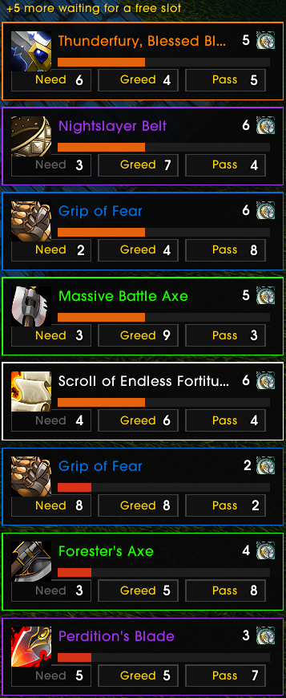

# CleanLoot

Clean loot roll frames for **WoW Forever** (the official Blizzard beta client). Lightweight and standalone.

  
  

## Features

- **Its own roll frames** in place of Blizzard's: item icon with tooltip (**Ctrl+click** to preview, **Shift+click** to link in chat), name and border coloured by quality, timer bar, and **Need / Greed / Pass** (Forever has no Disenchant or Transmog rolls)
- **Live vote counters**: a number on each button for how many players chose it, and on hover the list of players (class coloured, with the roll once the game reveals it) — also on a greyed-out button, which also tells you why it is unavailable
- **"Hasn't rolled yet"**: a small clock with the number of players still deciding; hover for who
- **Big drops**: more rolls than frames? The rest wait in a queue and appear as you answer, with their timers still running. No roll is lost
- **After a `/reload`**, rolls still running are brought back
- **Blizzard's own roll frames are hidden** (and stop catching clicks). the options bring them back
- **Less chat spam**: the per-roll lines (who selected what, roll values) are filtered out; **who won what** and your loot stay visible. Blizzard's *Loot Rolls* history window keeps everything
- **Winner popup**: when a roll ends, a small card shows who won and with which roll, and always your own roll (rolled, passed or did not answer). Hover it for every roll of the drop; right-click closes it. It stands in for the roll lines the chat filter hides
- **Loot toast options** (off by default): hide the "You won" banner (all of them, or only for the items the winner popup reports), shrink it, or move the alert banners (*Loot toasts* column of the options)
- **Minimap button**: left-click the loot history, right-click the options
- Options under *Game Menu → Options → AddOns → CleanLoot* (or just `/cll`): stacking direction, scale, position lock, Blizzard's frames, chat filter, loot toasts, minimap button

## Installation

- **CurseForge / WoW addon manager**: install *CleanLoot* for WoW Forever.
- **Manual**: download the zip from the [releases](https://github.com/hazaswow/CleanLoot/releases) and extract the `CleanLoot` folder into the `Interface/AddOns` folder of your WoW Forever install (`_classic_beta_` during the beta). The folder must be named exactly `CleanLoot` and contain `Libs/`.

## Commands

| Command | Effect |
|---|---|
| `/cll` | Open the options panel (every setting is there) |
| `/cll restore` | Bring back rolls still running (automatic at login and `/reload`) |
| `/cll sim [n]` | Simulate *n* loot rolls (1-8) with a simulated group, to try the frames without a real drop |
| `/cll sim colors` | One simulated drop of every item colour |
| `/cll sim group <n>` | Size of the simulated group (1-39 other players) |
| `/cll sim clear` | Remove the simulated rolls |
| `/cll debug [on\|off]` | Trace every roll in chat (why one did or did not show) |

## Notes

- Forever is still in beta and its API changes: if something breaks after a client update, please report it with the build number.
- The roll frames are **locked** by default, so a real roll never moves by accident. To place them: run `/cll sim` (they are always movable while simulating), then left-click and drag any frame. Or untick *Lock the frames' and popup's position* in the options. *Reset position* is there too. The winner popup has its own *Move* button in the options: it shows a sample card to drag (right-click it when done), whatever the lock says.
- *Moving* the toasts moves the whole alert-banner stack (achievements and the like too): Blizzard anchors them all to one point. *Hide* and *size* only touch loot toasts. If another addon already positions the alert banners, leave the toast position alone.
- Blizzard's roll frames are only ever hidden by alpha and mouse state: their managed container is never moved or resized, so nothing is tainted.

## Reporting bugs

Run `/cll debug on`, reproduce the issue, and share the chat lines with your client build.

## Author

**Hazas**
